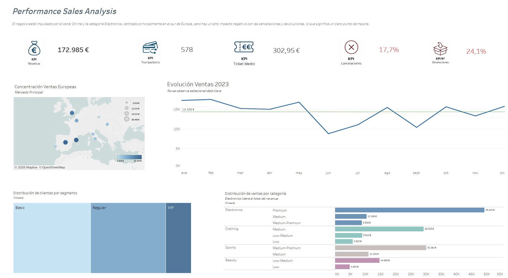

# Commerce Sales Performance Analysis

**Excel · SQL (PostgreSQL) · Tableau**

End-to-end analysis of a multi-product retail business in 2023. The business generated **172,985 €** in revenue, but **41.8% of orders were cancelled or returned**, and **114,255 € of revenue was lost** (39.7% of gross revenue).

*Leer en español: [README.es.md](README.es.md)*

**[View the interactive dashboard on Tableau Public ↗](https://public.tableau.com/app/profile/ana.fern.ndez.arias/viz/DashboardCommercePerfomanceAnalysis/Dashboard)**

---

## Business problem

A multichannel retailer (Online, Mobile, Store) selling Electronics, Clothing, Sports and Beauty products wants to know:

- What drives its revenue (categories, channels, cities, customers)
- Where it is losing money
- Which actions it should prioritise

## Pipeline

| Step | Tool | What was done |
| --- | --- | --- |
| 1. Data preparation | Excel | Enriched the original Kaggle sales table with Customers and Products tables, derived fields and business rules |
| 2. Exploratory analysis | PostgreSQL | Data quality checks and business questions in 4 blocks: performance, revenue drivers, customers, operations |
| 3. Visualisation | Tableau | Interactive dashboard with KPIs, monthly trend, map, category breakdown and customer segments as cross-filters |

## Dataset

Based on the Retail Sales Dataset (Kaggle), adapted and synthetically enriched to simulate a realistic business environment. Values were generated randomly from theoretical criteria defined beforehand; the figures below are the final distributions.

| Table | Rows | Content |
| --- | --- | --- |
| `transactions` | 1,000 | Date, customer, product, quantity, price, total amount, channel, order status, payment method |
| `customers` | 260 | Gender, age (18–70), city, subscription (≈16% subscribed), registration date (2019–2023) |
| `products` | 175 | Category (Clothing 42% · Beauty 25% · Electronics 17% · Sports 17%), price segment, base price |

Controlled NULL values were introduced on purpose (≈1% per field, 8.2% in `customer_id`). Excel formulas used to generate the data: [excel/data_generation_formulas.md](excel/data_generation_formulas.md).

## Key findings

| Finding | Figure |
| --- | --- |
| Revenue lost to cancellations and returns | 114,255 € (39.7% of gross revenue of 288,140 €) |
| Cancellation rate | 17.7% |
| Return rate | 24.1% (Clothing is the highest at 28.3%) |
| Revenue concentration in VIP customers | 30 VIP customers (14%) generate 37% of revenue with an identified customer |
| Main revenue driver | Electronics, 39.6% of revenue |
| E-commerce business | Online + Mobile = 85.9% of revenue |
| Beauty: high volume, low ticket | 2nd category by number of orders, but average ticket of 130 € (Electronics: 611 €) |
| Data quality | 9% of revenue has no customer assigned |

## Recommendations

| Priority | Action | Target | Estimated impact |
| --- | --- | --- | --- |
| 1 | Reduce cancellations: analyse why customers drop out, across all channels | 17.7% → below 12% | ≈ +15,200 € |
| 2 | Reduce returns, starting with Clothing (size guides, product pages) | 24.1% → below 18% | ≈ +17,200 € |
| 3 | Loyalty programme for VIP customers | Retain the 30 VIP customers | Protects 37% of revenue |
| 4 | Raise the Beauty ticket with bundles and cross-selling | Average ticket above 130 € | To be measured |
| 5 | Improve customer data capture | NULL `customer_id` below 2% | Makes 9% of revenue analysable |

Reaching targets 1 and 2 would recover about **32,400 € (+18.7% revenue)**. Estimate: orders no longer lost × average ticket of each order type (cancelled 266.57 €, returned 281.69 €).

## SQL scripts

Run them in order on a PostgreSQL database. Each query starts with the business question and the result obtained.

| Script | Content |
| --- | --- |
| [00_schema.sql](sql/00_schema.sql) | Table creation and CSV load |
| [01_data_quality.sql](sql/01_data_quality.sql) | NULLs per column, duplicates, dates out of range, unattributed revenue |
| [02_business_performance.sql](sql/02_business_performance.sql) | Total revenue, average ticket, monthly trend |
| [03_revenue_drivers.sql](sql/03_revenue_drivers.sql) | Revenue by category, price segment, channel and city |
| [04_customer_segmentation.sql](sql/04_customer_segmentation.sql) | Basic / Regular / VIP segmentation with revenue share |
| [05_operational_efficiency.sql](sql/05_operational_efficiency.sql) | Cancellation and return rates, lost revenue, rates by category and channel |

SQL techniques used: CTEs, CASE, JOINs, aggregations, window functions (`SUM() OVER ()`), NULL handling.

## How to reproduce

1. Create a PostgreSQL database (e.g. `commerce_retail_sales`).
2. Open `sql/00_schema.sql`, replace `<path>` with the local path to the `data` folder and run it. Expected: 260 customers, 175 products, 1,000 transactions.
3. Run scripts `01` to `05` in order.

## Limitations

- The data is partly synthetic, so findings illustrate the analysis process rather than a real company.
- Only one year of data: it is not possible to confirm seasonality.
- Two transactions dated January 2024 are kept and reported as an outlier.

---

**Ana F. Arias** · Junior Data Analyst · [Portfolio](https://claude.ai/artifact/GaLgmhGKkzFVNMzFqkDSGp)
